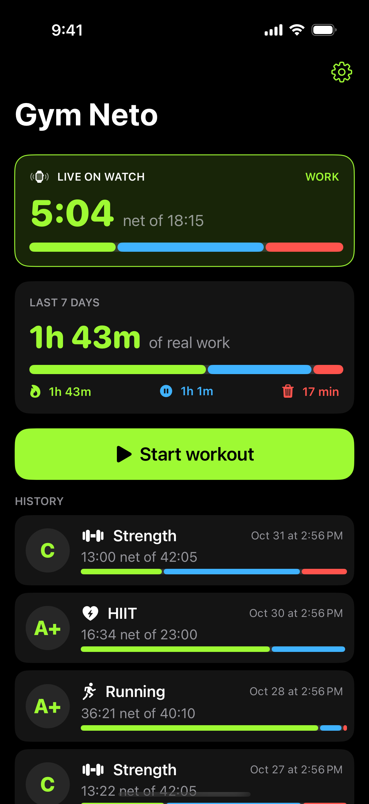
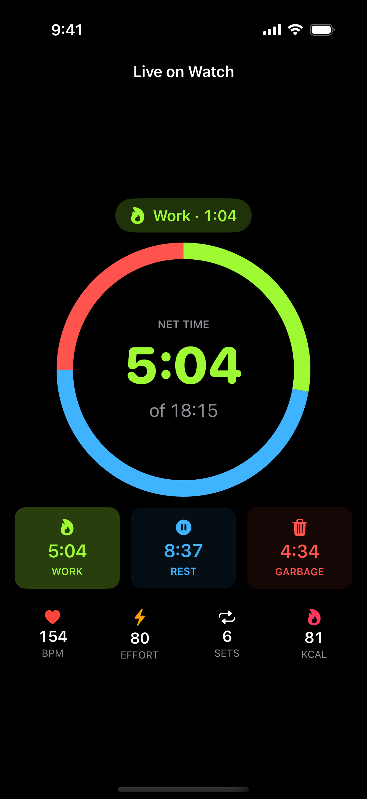
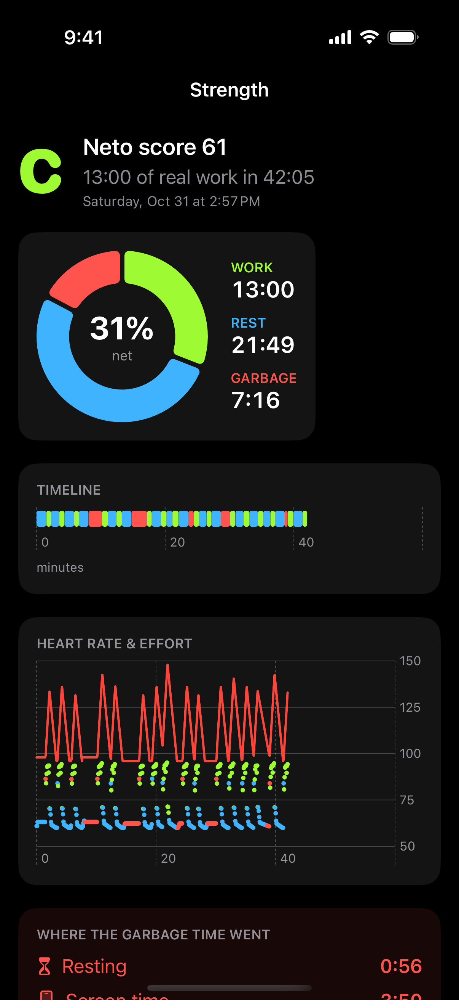
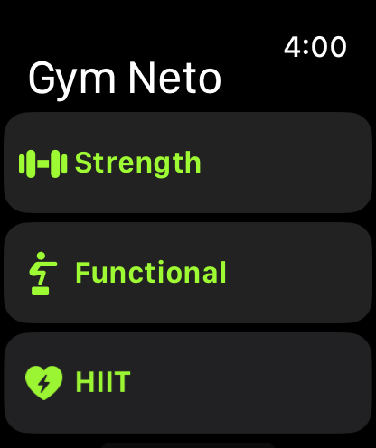
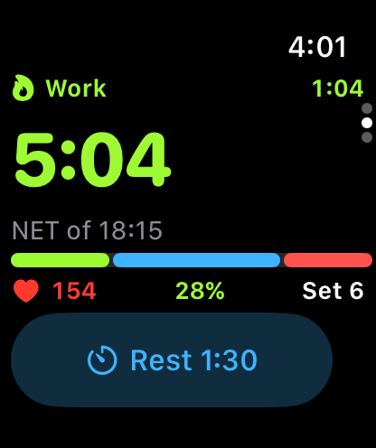
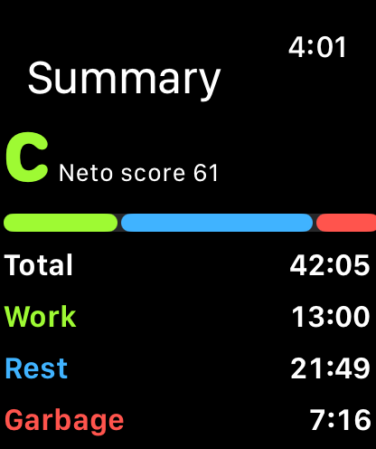

# Gym Neto

**Kill the garbage time in your workout.**

Gym Neto is an Apple Watch + iPhone app. You press start when you start training and it splits every second into:

| | State | What it means |
|---|---|---|
| 🟢 | **Work** | You are really training: reps, intervals, running |
| 🔵 | **Rest** | Healthy rest - only if your rest mode allows it (see below) |
| 🔴 | **Garbage** | Rest that ran too long, scrolling your phone, walking around |

You see it live on the watch and phone and get a full report at the end: net time, score (A+ to F), timeline, heart rate chart, where the garbage time went and coaching tips.

## Screenshots

| Home | Live | Summary |
|---|---|---|
|  |  |  |

| Watch: start | Watch: live | Watch: summary |
|---|---|---|
|  |  |  |

Made from the real app in the simulators with demo data (Actions -> Screenshots).

## How it knows you are working

Every second the app fuses these signals into one **effort score** (0-100):

- **Wrist motion** - accelerometer intensity (gravity removed), 25 Hz on Apple Watch
- **Wrist rotation** - gyroscope, catches curls, presses, rows
- **Heart rate level** - as % of *your* heart-rate reserve (resting + max HR pulled from Apple Health and your age)
- **Heart rate trend** - rising = working, falling fast = recovering (a lifter's HR stays high while resting, so the trend matters more than the level)
- **Active energy burn rate** - kcal/min from HealthKit
- **Step cadence** - pedometer, for running / cardio and for spotting "wandering"

Each workout type (Strength, Functional, HIIT, Cardio, Running, Cycling, Rowing, Boxing) weighs the signals differently. Hysteresis stops a single spike or a 3-second pause mid-set from flipping the state.

### Rest modes (you pick)

| Mode | How breaks count |
|---|---|
| **All rest is garbage** (default) | Only real work counts. Every break is garbage |
| **Short rest is OK** | Breaks under your rest limit are rest, longer ones are garbage |
| **Rest only with timer** | Rest counts only while the Rest timer runs |

The **Rest** button always starts a timer and the watch taps you when it ends.

### Garbage detectives

Garbage time is tagged with a reason:

- ⏳ **Resting** - a break that counts as garbage in your rest mode
- ⏱️ **Rest timer overrun** - you tapped Rest and did not start again when it ended
- 📱 **Screen time** - wrist raised + still with screen facing up (watch), or on iPhone: you left the app while the phone was unlocked
- 🚶 **Wandering** - slow walking with no effort (chatting, looking for a free machine)

The watch taps your wrist after 30 s of garbage time and every minute after that.

### Watch face widget

Add **Net Time** to any watch face (corner, circular, rectangular, inline). During a workout it shows your state and net time, counting live while you work. After, it shows today's net time and your last grade.

### iPhone Live Activity

Lock screen + Dynamic Island show net time (counting live while you work), state, heart rate, the rest timer and garbage time. It starts when the iPhone app is open (an iOS rule) - if you start on the watch with the phone app closed, it appears next time you open Gym Neto.

### iPhone only (no watch)

- **Pocket mode** - proximity sensor turns the screen off in your pocket while the app keeps sampling motion live
- **Lock gaps** - when the phone was locked, Core Motion activity history (still / walking / running) is replayed through the engine
- **Heart rate** - any heart rate written to Apple Health during the session (AirPods, chest straps, another watch app) is used

## Project layout

```
GymNetoKit/        Swift package - the net-time engine (pure Swift, unit tested)
  NetTimeEngine    work / rest / garbage state machine, totals, timeline, nudges
  EffortModel      sensor fusion -> effort score
  Insights         coaching tips for the summary
Shared/            Code used by both apps (motion sampler, Health baselines, theme)
GymNetoWatch/        watchOS app - HKWorkoutSession + live builder, haptics, live UI
GymNetoWatchWidgets/ watch face complications
GymNeto/             iOS app - start on watch, live mirror, iPhone-only mode, history, charts, settings
GymNetoWidgets/      iOS Live Activity (lock screen + Dynamic Island)
project.yml        XcodeGen spec
```

## Build

Needs a Mac with Xcode 15+.

```bash
brew install xcodegen
xcodegen generate
open GymNeto.xcodeproj
```

Set your Development Team on all 4 targets (and register the App Group `group.com.gymneto.app` for the watch app + watch widget), then run the `GymNeto` scheme on your iPhone (the watch app installs with it).

Run the engine tests:

```bash
cd GymNetoKit && swift test
```

## Settings

- **Rest mode** + **rest limit** - see the table above
- **Rest timer** - length of the Rest button timer
- **Nudge after** - when the watch taps you
- **Strictness** - how much effort is needed to count as work
- **Resting / max HR** - auto-filled from Apple Health
